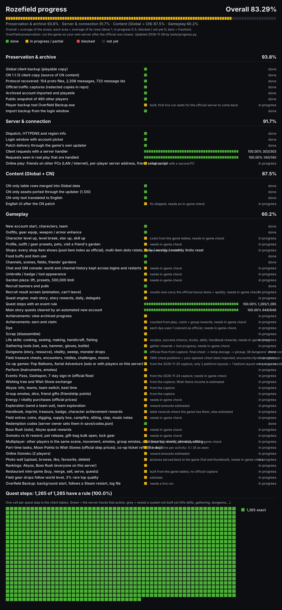

# Rozefield progress — 83.29%

`▰▰▰▰▰▰▰▰▰▰▰▰▰▰▰▰▰▰▰▰▰▰▰▰▰▰▰▰▰▰▰▰▰▱▱▱▱▱▱▱` **83.29%**

OverField preservation: run the game on your own server after the official one closes.

## The three parts

| Part | What it is | Get it |
|---|---|---|
| **Overfield** | The game. Not shared here (it belongs to its makers): use your own copy (Steam or the OverField launcher) and point it at a server with Overfield Backup, or the game package your server owner gives you | your own install |
| **Overfield Backup** (by RozenCrimsonvale) | Save your official account before 8 Feb 2027; **Play on Rozefield** points your own game at a server (a copy, or the game itself) | [Releases](https://github.com/Erorodata/Rozefield/releases/latest): `Overfield-Backup.zip` |
| **Overfield Server** (by RozenCrimsonvale) | Host a server: control panel with a setup wizard, sharing, traffic, imports, moving to another device; Windows, Linux or a VPS | [Releases](https://github.com/Erorodata/Rozefield/releases/latest): `Overfield-Server.zip` |

| Area | Progress | |
|---|---|---:|
| Preservation & archive | `▰▰▰▰▰▰▰▰▰▰▰▰▰▰▰▰▰▰▰▰▰▰▰▰▰▰▰▰▱▱` | **93.8%** |
| Server & connection | `▰▰▰▰▰▰▰▰▰▰▰▰▰▰▰▰▰▰▰▰▰▰▰▰▰▰▰▰▱▱` | **91.7%** |
| Content (Global + CN) | `▰▰▰▰▰▰▰▰▰▰▰▰▰▰▰▰▰▰▰▰▰▰▰▰▰▰▱▱▱▱` | **87.5%** |
| Gameplay | `▰▰▰▰▰▰▰▰▰▰▰▰▰▰▰▰▰▰▱▱▱▱▱▱▱▱▱▱▱▱` | **60.2%** |

🟩 done · 🟨 in progress · 🟥 blocked · ⬛ not yet

## Preservation & archive — 93.8%

| | Item | Status |
|---|---|---|
| 🟩 | Global client backup (playable copy) | done |
| 🟩 | CN 1.1.12 client copy (source of CN content) | done |
| 🟩 | Protocol recovered: 154 proto files, 2,308 messages, 733 message ids | done |
| 🟩 | Official traffic captures (redacted copies in repo) | done |
| 🟩 | Archived account imported and playable | done |
| 🟩 | Public snapshot of 490 other players | done |
| 🟨 | Player backup tool Overfield Backup.exe | in progress — built; first live run waits for the official server to come back |
| 🟩 | Import backup from the login window | done |

## Server & connection — 91.7%

| | Item | Status |
|---|---|---|
| 🟩 | Dispatch, HTTPDNS and region info | done |
| 🟩 | Login window with account picker | done |
| 🟩 | Patch delivery through the game's own updater | done |
| 🟩 | Client requests with a server handler | `▰▰▰▰▰▰▰▰▰▰▰▰▰▰▰▰▰▰▰▰` 100.00% 303/303 |
| 🟩 | Requests seen in real play that are handled | `▰▰▰▰▰▰▰▰▰▰▰▰▰▰▰▰▰▰▰▰` 100.00% 140/140 |
| 🟨 | Online play: friends on other PCs (LAN / internet), per-player server address, friend setup script | in progress — needs a test with a second PC |

## Content (Global + CN) — 87.5%

| | Item | Status |
|---|---|---|
| 🟩 | CN-only table rows merged into Global data | done |
| 🟩 | CN-only assets ported through the updater (1,120) | done |
| 🟩 | CN-only text translated to English | done |
| 🟨 | English UI after the CN patch | in progress — fix shipped, needs an in-game check |

## Gameplay — 60.2%

| | Item | Status |
|---|---|---|
| 🟩 | New account start, characters, team | done |
| 🟩 | Outfits, gear equip, weapon / armor enhance | done |
| 🟨 | Character level up, level break, star up, skill up | in progress — costs from the game tables; needs in-game check |
| 🟨 | Profile, outfit / gear presets, pets, visit a friend's garden | in progress — needs in-game check |
| 🟨 | Shops: every shop item shows (pool item index as official), multi-item slots rotate, daily / weekly / monthly limits reset | in progress — needs in-game check |
| 🟩 | Food buffs and item use | done |
| 🟩 | Channels, scenes, fields, friends' gardens | done |
| 🟨 | Chat and GM console: world and channel history kept across logins and restarts | in progress — needs in-game check |
| 🟨 | Umbrella / badge / tool appearance | in progress — needs in-game check |
| 🟨 | Garden plaza: lift, presets, 500,000 limit | in progress — needs in-game check |
| 🟩 | Recruit banners and pulls | done |
| 🟨 | Recruit result screen (animation, can't leave) | in progress — results now carry the official bonus items + quality; needs in-game check |
| 🟨 | Quest engine: main story, story rewards, daily, delegate | in progress |
| 🟩 | Quest steps with an event rule | `▰▰▰▰▰▰▰▰▰▰▰▰▰▰▰▰▰▰▰▰` 100.00% 1,265/1,265 |
| 🟩 | Main story quests cleared by an automated new account | `▰▰▰▰▰▰▰▰▰▰▰▰▰▰▰▰▰▰▰▰` 100.00% 648/648 |
| 🟨 | Achievements: view archived progress | in progress |
| 🟨 | Achievements: earn and claim | in progress — counted from play, claim + group rewards; needs in-game check |
| 🟨 | Dye | in progress — each dye uses 1 colorant as official; needs in-game check |
| 🟨 | Scrap (disassemble) | in progress |
| 🟨 | Life skills: cooking, sewing, making, handicraft, fishing | in progress — recipes, success chance, levels, skills, handbook rewards; needs in-game check |
| 🟨 | Gathering tools (net, axe, hammer, gloves, bottle) | in progress — gather rewards + tool progress; needs in-game check |
| 🟩 | Dungeons (story, resource), vitality, sweep, monster drops | done — official flow from capture: final chest -> temp storage -> pickup; 38 dungeons' chest contents observed |
| 🟨 | Field treasure chests, encounters, riddles, challenges, moons | in progress — 1300 chest positions + your opened-chest state imported; encounter/dynamic chest per capture; field chest amounts approximated |
| 🟨 | Co-op games: Pop Balloons, Aerial Adventure (solo or with players on this server) | in progress — from the 2026-11-25 capture; only 2 platform layouts + 1 balloon layout were seen; needs in-game check |
| 🟨 | Perform (instruments, emotes) | in progress |
| 🟨 | Events: Pass, Gashapon, 7-day sign-in (official flow) | in progress — from the 2026-11-24 capture; needs in-game check |
| 🟨 | Wishing tree and Wish Stone exchange | in progress — from the capture; Wish Stone income is estimated |
| 🟨 | Abyss: info, teams, team switch, best time | in progress — from the capture |
| 🟨 | Group emotes, dice, friend gifts (friendship points) | in progress — from the capture |
| 🟨 | Energy / vitality purchases (official prices) | in progress — needs in-game check |
| 🟨 | Exploration (send a team out), team exploration | in progress — reward amounts estimated |
| 🟨 | Handbook, imprint, treasure, badge, character achievement rewards | in progress — table rewards where the game has them, else estimated |
| 🟨 | Field extras: coins, digging, supply box, campfire, sitting, clap, music notes | in progress — needs in-game check |
| 🟩 | Redemption codes (server owner sets them in save/codes.json) | done |
| 🟨 | Boss Rush (solo), Abyss quest rewards | in progress — needs in-game check |
| 🟨 | Gomoku vs AI reward, pet release, gift-bag bulk open, lock gear | in progress — needs in-game check |
| 🟨 | Multiplayer: other players in the same scene, movement, emotes, group emotes, chat (nearby, world, private), sitting | in progress — tested with 2 local clients; needs in-game check |
| 🟨 | Part-time tasks, Moon Points to Wish Stones (official step prices), co-op ticket refill (6 a day) | in progress — Moon Points per activity: 5 / 25 as seen |
| 🟨 | Online Gomoku (2 players) | in progress — reward amounts estimated |
| 🟨 | Photo wall (upload, browse, like, favourite, delete) | in progress — pictures served back to the game (full and thumbnail); needs in-game check |
| 🟨 | Rankings: Abyss, Boss Rush (everyone on this server) | in progress |
| 🟨 | Restaurant mini-game (buy, merge, sell, serve, quests) | in progress — built from the game tables; no official capture |
| 🟨 | Field gear drops follow world level, 3% rare top quality | in progress — estimate |
| 🟨 | Overfield Backup: background start, follows a Steam restart, log file | in progress — needs a live run |

**Quest steps with a rule:** 1,265 / 1,265 (`▰▰▰▰▰▰▰▰▰▰▰▰▰▰▰▰▰▰▰▰▰▰▰▰▰▰▰▰▰▰` 100.0%)

_Updated 2026-11-26 by `py devtools/progress.py` from [docs/checklist.json](docs/checklist.json)._

## About

Rozefield preserves OverField: the archived client and a private server that runs it after the official shutdown.

- [Archive notes: client build, endpoints, protocol, captures](docs/ARCHIVE.md)
- [Server: setup, login window, backup / import, GM commands](server/README.md)
- [Host your own server](docs/HOSTING.md)
- [Checklist (plain)](docs/PROGRESS.md)
