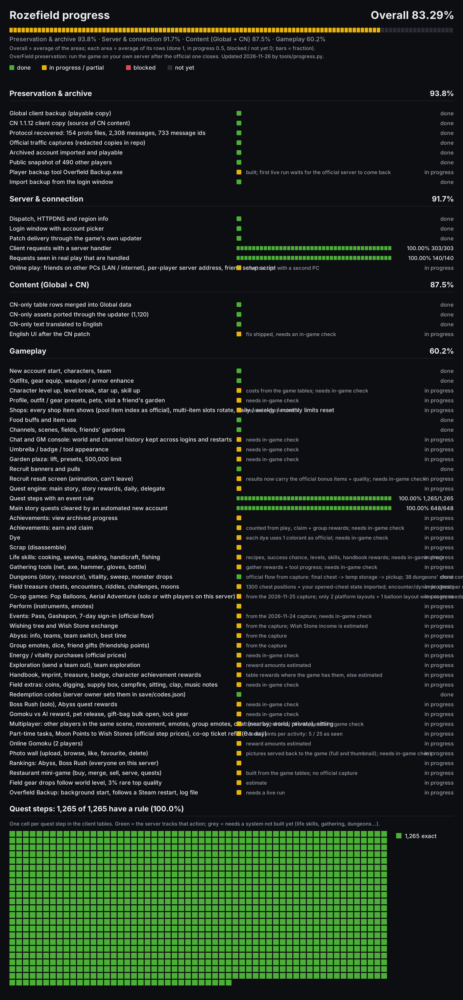

# Rozefield progress: 75.03%

_OverField preservation: run the game on your own server after the official one closes. Updated 2026-11-24; regenerate with `py server/tools/progress.py`._

## Preservation & archive (93.8%)

- [x] Global client backup (playable copy)
- [x] CN 1.1.12 client copy (source of CN content)
- [x] Protocol recovered: 154 proto files, 2,308 messages, 733 message ids
- [x] Official traffic captures (redacted copies in repo)
- [x] Archived account (Player) imported and playable
- [x] Public snapshot of 490 other players
- [~] Player backup tool RozefieldBackup.exe: built; first live run waits for the official server to come back
- [x] Import backup from the login window

## Server & connection (69.8%)

- [x] Dispatch, HTTPDNS and region info
- [x] Login window with account picker
- [x] Patch delivery through the game's own updater
- [~] Client requests with a server handler (29.70% 90/303)
- [~] Requests seen in real play that are handled (88.89% 80/90)
- [ ] Multiplayer (other players in scenes, co-op): phase 2

## Content (Global + CN) (87.5%)

- [x] CN-only table rows merged into Global data
- [x] CN-only assets ported through the updater (1,120)
- [x] CN-only text translated to English
- [~] English UI after the CN patch: fix shipped, needs an in-game check

## Gameplay (49.1%)

- [x] New account start, characters, team
- [x] Outfits, gear equip, weapon / armor enhance
- [x] Shops (Rhombite shop gives the item)
- [x] Food buffs and item use
- [x] Channels, scenes, fields, friends' gardens
- [~] Chat and GM console (no double text): needs in-game check
- [~] Umbrella / badge / tool appearance: needs in-game check
- [~] Garden plaza: lift, presets, 500,000 limit: needs in-game check
- [x] Recruit banners and pulls
- [!] Recruit result screen (animation, can't leave): needs the game's Player.log
- [~] Quest engine: main story, story rewards, daily, delegate
- [~] Quest steps with an event rule (74.39% 941/1,265)
- [~] Main story quests cleared by an automated new account (6.33% 41/648)
- [~] Achievements: view archived progress
- [ ] Achievements: earn and claim
- [~] Dye: colorants not consumed yet
- [~] Scrap (disassemble)
- [ ] Life skills: cooking, fishing, sewing, crafting, making
- [ ] Gathering tools (net, axe, hammer, gloves, bottle)
- [ ] Dungeons and field monster drops
- [ ] Mini-games and co-op (game hall)
- [~] Perform (instruments, emotes)

Legend: `[x]` done, `[~]` in progress, `[!]` blocked, `[ ]` not yet.

Requests seen in play that still get an empty answer: `AbyssInfoReq`, `CookingFoodReq`, `DailyTaskExchangeReq`, `DungeonEnterReq`, `DungeonExitReq`, `DungeonFinishReq`, `DungeonOperateReq`, `FriendHandleReq`, `MultipleActionAcceptReq`, `SewingReq`
